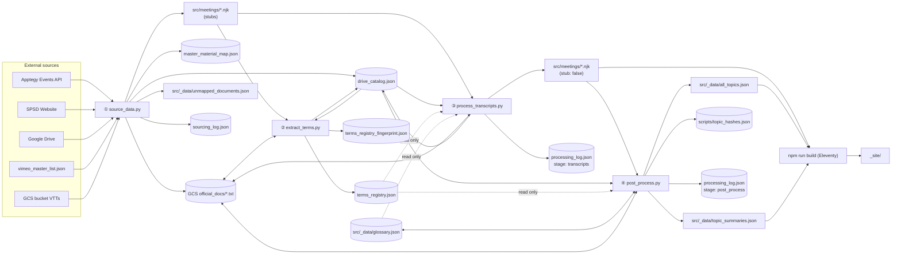
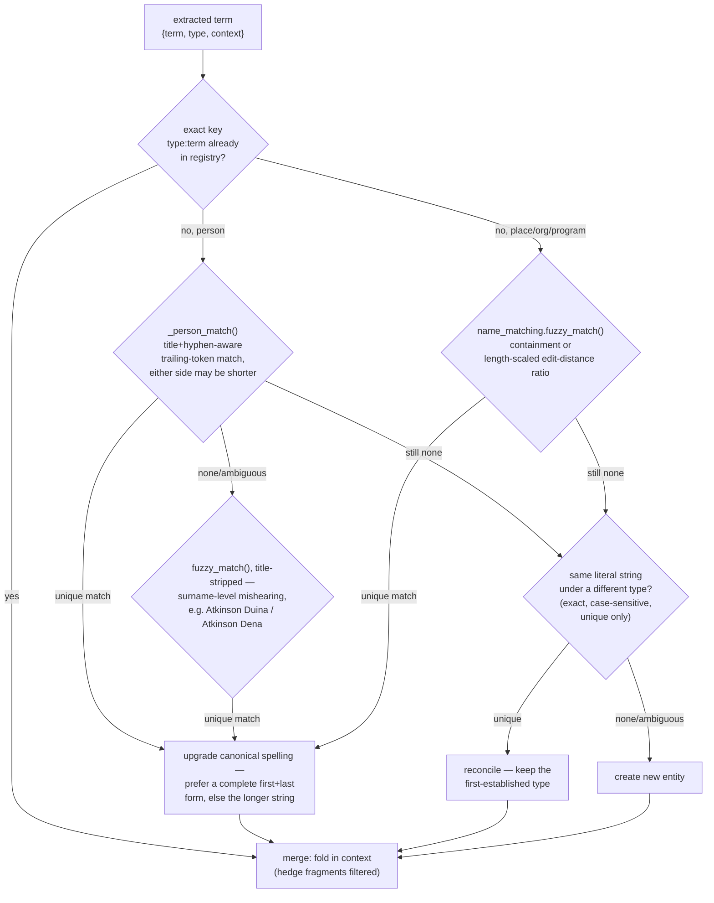
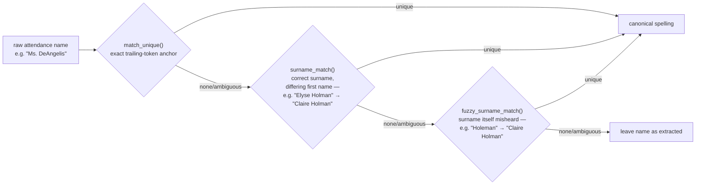
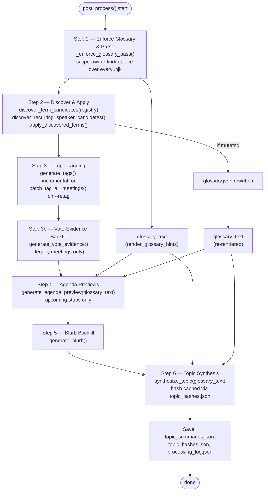

# Data Pipeline Reference

Technical reference for the four-stage ingestion and synthesis pipeline. All scripts live in `scripts/` and are run from the repo root.

---

## Pipeline at a Glance

Four scripts run in a fixed order. Each reads what the previous stage wrote; two GCS-hosted,
corpus-wide stores (`drive_catalog.json`, `terms_registry.json`) and one git-tracked store
(`src/_data/glossary.json`) are shared across stages ②-④, which is what lets spelling
corrections discovered from one meeting's official documents improve a different meeting's
generated content.



Cylinders are GCS-hosted, never git-tracked (too large/generated for a useful diff — same
reasoning applies to all four: `drive_catalog.json`, `terms_registry.json`, the small sibling
`terms_registry_fingerprint.json`, the per-document `official_docs/*.txt` cache, and the run
logs). Everything else is git-tracked. `glossary.json` is the one store both read *and* written
by stage ④ and only *read* by stage ③, since stage ③'s `GLOSSARY_HINTS` is rendered once at
import time (see [Glossary auto-discovery](#glossary-auto-discovery-scriptsglossary_utilspy)) —
it never writes the file back. `terms_registry.json` is written only by stage ② now (a
from-scratch rebuild, not an accumulated mutation — see
[The Terms Registry](#the-terms-registry-scriptsterms_registrypy)) and only ever read by stages
③-④.

`drive_catalog.json` and `GCS official_docs/*.txt` are the two true hub resources — every stage
②-④ reads and writes both (official_docs/*.txt directly via `drive.get_or_extract_text`/
`cache_text`/`write_blob` for its own cache-miss extractions and derived blobs, e.g.
post_process.py's isolated-agenda-excerpt cache). In the diagram above this shows up as several
long edges doubling back from the right toward stages placed further left by mermaid's
left-to-right auto-layout — if a rendered/cropped view only shows a stage's node and its
immediately-adjacent edges, it's easy to misread a stage as sourcing from a single upstream node
when it's actually also reading/writing one or both of these shared stores.

### Pipeline Stages

| # | Script | Trigger | Purpose |
|---|--------|---------|---------|
| 1 | `scripts/source_data.py` | Daily CI / manual | Discover meetings from authority sources; create/update `.njk` stubs |
| 2 | `scripts/extract_terms.py` | Daily CI / manual | Batch-extract canonical proper-noun terms from official documents into `drive_catalog.json`; rebuild the Terms Registry from the catalog's current state (fingerprint-gated skip when nothing qualifying changed) |
| 3 | `scripts/process_transcripts.py` | Daily CI / manual | Analyze `.vtt` transcripts with Gemini; populate per-meeting AI fields; canonicalize attendance names against the Terms Registry |
| 4 | `scripts/post_process.py` | Daily CI / manual | Grow `glossary.json` from the Terms Registry plus each meeting's own generated content; enforce the glossary; sort topic taxonomy; synthesize cross-meeting topic summaries |

### LLM Calls

Every distinct LLM call in the pipeline, in the order it runs. Every call goes through the shared
`call_llm()` in `scripts/model_config.py`, which tries `DEFAULT_MODEL` → `BACKUP_MODEL`
(`gemini-2.5-pro` falling back to `gemini-3.5-flash` on a 429). Every call also shares the same
`VERTEX_LOCATION` (`'global'` — required for the `BACKUP_MODEL` fallback to work at all, since
`gemini-3.5-flash` isn't served on regional Vertex AI endpoints; see commit `c773440`) and the
same `DEFAULT_TEMPERATURE` (0.1) — no call in the pipeline has a documented reason to run hotter
or colder than any other, so this isn't tuned per call. Every call also gets a subprocess
SIGTERM hard-kill timeout so none can hang the pipeline indefinitely; it defaults to
`DEFAULT_TIMEOUT` (120s) except for two calls whose payload is genuinely much larger than
everything else — `TRANSCRIPT_TIMEOUT` (300s, #1: a full meeting transcript) and `BATCH_TIMEOUT`
(600s, #6: the entire meeting corpus in one call). Full prompt text, injected context, and output
schema for each are in [prompts.md](prompts.md) — "Ref" below is that section.

| # | Call | Function | Model | Purpose | Ref |
|---|------|----------|-------|---------|-----|
| 1 | Transcript Extraction | `process_transcripts.py::process_single_meeting()` | pro → flash | blurb/votes/summary/timeline/attendance from the meeting's VTT transcript, grounded with `glossary.json` hints plus this meeting's own cached official-document terms | [prompts.md §1](prompts.md#1-transcript-extraction-process_transcriptspy) |
| 2 | Votes/Attendance Override | `process_transcripts.py::_extract_votes_attendance_from_doc()` | pro → flash | overrides #1's votes/attendance from an official minutes/summary doc, when one is available | [prompts.md §9](prompts.md#9-votesattendance-override-from-official-document-process_transcriptspy) |
| 3 | Official Document Term Extraction (batched) | `extract_terms.py::_extract_batch()` | pro → flash | canonical proper-noun spellings from agenda/packet/minutes PDFs, several documents per call (`TERMS_BATCH_SIZE`) — cached inline on the Drive catalog entry (`extractor_version`-gated), consolidated into the corpus-wide Terms Registry, and fed back into #1's glossary hints | [prompts.md §6](prompts.md#6-official-document-term-extraction-extract_termspy) |
| 4 | Agenda Text Retrieval (packet-isolation fallback) | `post_process.py::_load_cached_agenda_text()` | pro → flash | isolates agenda items from a packet PDF when no standalone agenda doc exists, cached | [prompts.md §4](prompts.md#4-agenda-text-retrieval-post_processpy) |
| 5 | Topic Tag Generation — Single Meeting | `post_process.py::generate_tags()` | pro → flash | assigns 3-5 topic tags to one meeting and associates its votes with those tags, incremental daily path | [prompts.md §2](prompts.md#2-topic-tag-generation--single-meeting-post_processpy) |
| 6 | Topic Tag Generation — Batch | `post_process.py::batch_tag_all_meetings()` | pro → flash | re-tags the entire corpus (and its votes) in one call, `--retag` only | [prompts.md §3](prompts.md#3-topic-tag-generation--batch-post_processpy) |
| 7 | Vote-Topic Evidence (legacy backfill) | `post_process.py::generate_vote_evidence()` | pro → flash | backfills vote-topic association only for meetings tagged before this merged into #5/#6 | [prompts.md §10](prompts.md#10-vote-topic-evidence-post_processpy) |
| 8 | Agenda Preview | `post_process.py::generate_agenda_preview()` | pro → flash | upcoming-meeting agenda `<ul>` preview for still-stub meetings, grounded with `glossary.json` hints | [prompts.md §7](prompts.md#7-agenda-preview-post_processpy) |
| 9 | Blurb Generation | `post_process.py::generate_blurb()` | pro → flash | backfills a missing 1-2 sentence meeting blurb | [prompts.md §8](prompts.md#8-blurb-generation-post_processpy) |
| 10 | Topic Synthesis | `post_process.py::synthesize_topic()` | pro → flash | writes a topic's `current_status`/`overview`/`perspectives` from all its evidence, grounded with `glossary.json` hints | [prompts.md §5](prompts.md#5-topic-synthesis-post_processpy) |

Call 3 now runs earliest of all of them, batched across the whole corpus inside
`extract_terms.py` (stage ②) — before any meeting's transcript is processed. Calls 1-2 run once
per meeting inside `process_transcripts.py` (stage ③), downstream of call 3. Calls 4-10 all live
in `post_process.py` (stage ④) and run in this order within one pass (see
[Pipeline Sequencing](#pipeline-sequencing-inside-post_processpy)). Which model actually served
each call is recorded per-item in `processing_log.json` — see [Run Log Schema](#run-log-schema).

---

## Canonical Spelling: the Terms Registry and `glossary.json`

Raw material (auto-captioned video, OCR'd/extracted PDF text) produces noisy *surface forms* of a
fixed-but-growing set of real-world people, places, organizations, and programs. Two cooperating
mechanisms turn that into one consistent spelling everywhere the entity appears:

- **The Terms Registry** (`scripts/terms_registry.py`) — a corpus-wide, lineage-tracked ledger of
  every proper noun ever extracted from an *official* document (agenda/packet/minutes). This is
  the vetted, human-authored ground truth.
- **`glossary.json`** (`scripts/glossary_utils.py`) — a smaller, git-tracked file of corrections
  *discovered* by comparing the registry (and cross-meeting frequency, as a fallback) against each
  meeting's own *generated* content (transcripts, AI summaries). This is what actually gets
  injected into prompts and deterministically find/replaced into `.njk` files.

Both are built on one shared primitive, `scripts/name_matching.py` — there is exactly one place
each kind of near-miss comparison (surname anchoring, fuzzy edit-distance, title-stripping,
completeness) is implemented, reused by registry self-consolidation, glossary discovery, and
attendance canonicalization alike. See [todos/019](../todos/019-pending-p2-terms-registry-and-living-glossary.md)
for the full design history — this section documents where that work landed.

```mermaid
flowchart LR
    DOCS["agenda / packet / minutes<br/>(official documents only)"] --> EXTRACT["extract_terms.py<br/>_extract_batch()<br/>LLM call #3 (batched)"]
    EXTRACT --> CATTERMS["drive_catalog.json<br/>entry['terms']<br/>(per-document cache)"]
    CATTERMS --> FPCHECK{"registry_fingerprint()<br/>changed since last rebuild?"}
    FPCHECK -->|no| REG[("terms_registry.json")]
    FPCHECK -->|yes| REBUILD["build_registry_from_catalog()<br/>(fresh, deterministic, serial —<br/>calls ingest_document_terms()<br/>once per qualifying doc)"]
    REBUILD --> REG

    REG --> CANON["terms_registry.canonical_person()"]
    CANON --> ATTEND["process_transcripts.py<br/>board_attendance names"]

    REG --> DISC["glossary_utils.py<br/>discover_term_candidates()"]
    NJKCONTENT["each meeting's own<br/>generated content"] --> DISC
    NJKCONTENT --> RECUR["discover_recurring_speaker_candidates()<br/>(registry-blind fallback)"]
    DISC --> APPLY["apply_discovered_terms()"]
    RECUR --> APPLY
    APPLY --> GLOS["src/_data/glossary.json"]

    GLOS --> HINTS["render_glossary_hints()"]
    HINTS --> PROMPTS["LLM calls #1, #2, #8, #10"]
    GLOS --> ENFORCE["_enforce_glossary_pass()<br/>(scope-aware find/replace)"]
    ENFORCE --> NJKFILES["src/meetings/*.njk"]
```



### The Terms Registry (`scripts/terms_registry.py`)

A single, corpus-wide, lineage-tracked artifact (`terms_registry.json`, GCS-hosted) consolidating
every proper noun ever extracted from an official document, deduplicated across documents and
meetings. This replaced the former per-document `terms_blob` design (one fragment per document,
never consolidated).

Keyed by `type:canonical-string` — e.g. `person:Claire Holman`:

```json
{
  "person:Claire Holman": {
    "term": "Claire Holman",
    "type": "person",
    "context": "Board of Education member",
    "first_seen": "2026-08-17",
    "last_seen": "2026-09-14"
  }
}
```

No `sources`/per-document lineage field — the registry is a from-scratch rebuild of the catalog's
current state each time it changes (see "Derived rebuild, not an accumulated ledger" below), so
there's nothing to accumulate per-entity between runs; `first_seen`/`last_seen` alone already
capture the date range (see [todos/022](../todos/022-pending-p2-registry-schema-scalability.md)).

**Source scope: official documents only, never the `.vtt` transcript.** `extract_terms.py` only
reads `docs` of type `agenda`/`packet`/`minutes`; there is no path anywhere in the pipeline that
extracts registry terms from a meeting's transcript. This is intentional, not an oversight — a
transcript is auto-captioned, ASR-derived text ([lowest-priority source](#field-level-data-priority)
for exactly that reason), while an official document is vetted, human-authored text, so adding a
VTT-derived extraction path would mean folding a lossy, lower-confidence source into the registry's
canonical-spelling ground truth. If a meeting has no qualifying official documents, it simply
contributes no terms to the registry for that run.

**Per-document term caching, inline on the catalog.** `extract_terms.py` stores/reads
`entry['terms']` directly on the already-once-per-run `drive_catalog.json` dict rather than a
separate GCS blob pointer — the catalog is already loaded/saved once per run, so a cache hit costs
no extra network round trip. A cache hit is only trusted when *both* `modified_time` matches the
live Drive file *and* `entry['extractor_version']` matches `drive.TEXT_EXTRACTOR_VERSION` — terms
are derived from extracted text, so a `modified_time` match alone proves the file hasn't changed,
not that the text it was last extracted from is still trustworthy (see
[The Drive catalog](#the-drive-catalog-drive_catalogjson)). A legacy `terms_blob` pointer with no
inline `terms` yet is hydrated once on next touch, then dropped.

**No redundant Drive metadata calls.** `_ensure_cache_metadata()` only calls Drive's API for a
file whose catalog entry doesn't already carry `modified_time`/`mime_type` — which covers almost
every in-scope document, since `source_data.py`'s folder scan (`build_meeting_map`, same job, run
moments earlier) already keeps those fields current for everything within its scope. A live call
only happens for a document that scan never saw. A file that 404s is flagged `access: "no_access"`
on the catalog entry and never retried — its last-cached terms keep being used by the registry
rebuild below, but no further Drive calls are made for it on any later run.

**Derived rebuild, not an accumulated ledger.** `build_registry_from_catalog()` builds the
registry fresh from `{}` every time it runs — iterating every meeting in a fixed deterministic
order (meeting date ascending, then doc_type priority agenda→packet→minutes, then `file_id` as a
tiebreak for a meeting with more than one document of the same type) and replaying
`ingest_document_terms()` once per qualifying document. Because the output is wholly
reconstructed from the catalog's *current* `terms`, a document that stops producing a term it
once did simply doesn't re-contribute it — no explicit retraction logic needed. A
`registry_fingerprint()` — the sorted `(file_id, extractor_version, modified_time)` for every
qualifying document, stored as a sibling `terms_registry_fingerprint.json` blob — lets
`extract_terms.py` skip the rebuild entirely on the common case where nothing qualifying changed
since the last run; a rebuild only actually happens when that fingerprint changes (see
[todos/026](../todos/026-complete-p2-dedicated-term-extraction-and-derived-registry-rebuild.md)).
This also means a `TEXT_EXTRACTOR_VERSION` bump no longer needs a manual reset-and-rebuild
workflow — every qualifying entry's fingerprint changes at once, which naturally triggers one
ordinary full rebuild through this same standing path.

**Ingestion matching chain.** `ingest_document_terms()` (no longer thread-safe or needing to
be — it's only ever called from `build_registry_from_catalog()`'s single serial rebuild pass, not
concurrently) folds each freshly-extracted-or-cached term into an existing entity rather than
forking a disconnected duplicate:



Every matcher here degrades safely: ambiguity (zero or 2+ candidates) never guesses, it falls
through to the next, weaker check, and ultimately to creating a new entity rather than risking a
wrong merge. `context` accumulates semicolon-joined fragments across sources, filtered through a
backstop regex (`_is_hedge_fragment`) that drops Gemini's own hedging ("likely a board member",
"present at the meeting") rather than letting it accumulate as a wall of near-duplicate
non-facts — the prompt itself (LLM call #3) also asks for stable facts only, but this catches
whatever still slips through non-deterministically.

**Attendance-name canonicalization** (`canonical_person()`, used by `process_transcripts.py`)
resolves an extracted attendance name to its registry canonical spelling via the same three
matchers, in increasing order of fuzziness, each a safe-degrade step on the one before it:



This only *formats* a name already extracted from the transcript/official document — it never
adds, removes, or determines who attended. This replaced `board_members.json` and
`scripts/board_members_utils.py` entirely, which were retired: the file's only load-bearing job was
this same spelling canonicalization, now served by the registry on firmer footing (no
unreconstructable manually-entered term dates); its only other job (next-meeting attendance stub
seeding in `source_data.py`) was already dead code — no template ever read it — and was deleted
outright, not replaced.

### Glossary auto-discovery (`scripts/glossary_utils.py`)

`src/_data/glossary.json` grows automatically, with **no human-review step** — every entry is
discovered the same way, applied immediately but scoped to the meeting(s) that produced the
evidence, and widened to every meeting once independently confirmed across
`PROMOTION_THRESHOLD` (2) distinct meetings. There is no "hand-curated vs. auto-discovered"
distinction left anywhere in the schema or the code — the file's original 7 hand-typed entries
were deleted outright during this branch's rebuild, since keeping them as permanently-protected
seed data the corpus itself no longer corroborates contradicted the rest of the design (see
[todos/019](../todos/019-pending-p2-terms-registry-and-living-glossary.md) work log, 2026-11-15).

A real entry, as currently written:

```json
{ "correct": "Mr. Daniel Feller", "aliases": ["Member Feller"], "note": "Board of Education, B&G Committee Chairman", "type": "person", "scope": ["2026-10-26"] }
```

`aliases` (legitimate alternate forms — shortform, title, nickname) and `misspellings` (genuine
transcription errors) are split for readability only — both are corrected the same way, by the same
find/replace enforcement; `scope` is present because this entry hasn't yet been independently
confirmed from a second meeting.

**Two discovery sources**, run once per `post_process.py` pass, after the Terms Registry is
updated for this run:

- **`discover_term_candidates(meeting_data, registry)`** compares one meeting's own generated
  content (timeline speakers, topic-title attribution, free text) against the *entire* registry,
  not just that meeting's own documents — an entity named in one meeting's agenda can correct a
  mishearing of the same entity in a different meeting's generated content. Dispatches by type:
  - **Person names**: the same `match_unique` → `surname_match` → `fuzzy_surname_match` chain used
    for attendance canonicalization. A hit is classified `kind: 'alias'` when the two forms are a
    legitimate shortform/longform or nickname relationship (`is_subset_name`,
    `is_nickname_variant` — "Holman" within "Claire Holman", "Jo"/"Johanna") and `kind:
    'misspelling'` otherwise (a genuine conflicting first name, or any surname-level mishearing).
    Whichever side is the complete `first_name last_name` form becomes `correct`, even when that's
    the raw mention rather than the registry's own term — an official document stating only "Ms.
    Holman" never asserted there's no first name, just omitted it. A bare surname alone ("Smith")
    is dropped rather than filed as an alias: there's no misspelling to correct, and persisting it
    as a sitewide find/replace target risks rewriting an unrelated same-surname person later.
  - **Place/organization/program names**: no "surname" to anchor on, so a per-token comparator
    (`_tokens_match`) slides a same-length window across each meeting's free text, requiring every
    token position to independently agree (not just a leading anchor) — the fix for a 2026-11-13
    production incident where a shared generic trailing phrase ("...Elementary School") let an
    unrelated leading word slip through a whole-string ratio check and corrupted `glossary.json`
    with hundreds of false entries. `_tokens_match` also rejects a candidate token outright when
    it's an ordinary dictionary word (`name_matching.is_dictionary_word`, backed by a checked-in
    filtered copy of the macOS/BSD `words(5)` list, `scripts/common_words.txt`) — closing a second,
    related false-positive class where a registry entity that's also a short common word ("State",
    "Board", "Maine") fuzzy-matched unrelated real words ("start", "broad", "machine") via the same
    ratio fallback; confirmed live at 326 of 1,781 preview replacement occurrences before the fix
    (see [todos/024](../todos/024-complete-p1-glossary-discovery-false-positive-aliases.md)).
- **`discover_recurring_speaker_candidates(meetings_data)`** is the fallback of last resort, for
  entities the registry has no record of at all (a recurring public commenter never named in any
  official document). Groups generated-content names by surname across the whole corpus; a
  complete spelling that dominates by frequency over a strictly-less-frequent bare-surname/titled
  spelling of the same surname is flagged as the correction. **Deliberately never resolves two
  conflicting complete spellings of the same surname against each other** (e.g. "Melinda Hall" vs.
  "Angelica Hall") — a conflicting first name is, from text alone, indistinguishable between "one
  person's name was misheard" and "two different people share a surname," and this fallback has no
  registry/official-document corroboration to tell those apart the way `discover_term_candidates`
  does.

Both sources dedupe within and across themselves (`dedupe_observations`) before
**`apply_discovered_terms(glossary_entries, observations)`** mutates the file: an observation
either widens an existing entry's `scope`/alias list, merges into an existing entry via the same
`match_unique`/`fuzzy_match` collision check (never into an entry of a known-but-different `type`),
or becomes a brand-new scoped entry. `scope` is removed entirely once it reaches
`PROMOTION_THRESHOLD` distinct meetings, at which point the entry applies everywhere. A guard
(`_plausible_correct_spelling`) rejects anything that looks like a missing-space PDF-extraction
artifact ("SouthPortlandWineCompany") before it can ever become a `correct` value.

`render_glossary_hints()` drops `note` from what's shown to the model on every entry, always — a
pure spelling hint (`correct`/`aliases`/`misspellings`) is timeless-safe to assert into every
meeting's prompt regardless of date; a role/context note is not, which is the exact bug class that
originally motivated [todos/013](../todos/013-pending-p2-consolidate-glossary-artifact.md). This
is also why `render_glossary_hints()` is **unaffected by `scope`** — a spelling correction doesn't
need corroboration to be timeless-safe — while the deterministic find/replace pass
(`_enforce_glossary_pass` / `replacements_for_meeting`) *is* scope-aware, applying a
not-yet-promoted entry only to the meeting(s) that produced its evidence. That pass substitutes via
`glossary_utils.apply_replacements`, a `\b`-anchored word-boundary-safe replace — not a raw
`content.replace()` — so a short correct-spelling substring can't clobber an unrelated word that
happens to contain it.

### Spelling priority

Parallel to the existing [content priority](#field-level-data-priority) (what happened), this is
the precedence for *how to spell a name*, highest confidence first:

1. **`glossary.json` entries with no `scope`** — global, independently confirmed across 2+
   meetings. No distinction between a hand-typed origin and a promoted auto-discovery; there is no
   such distinction left in the schema.
2. **The Terms Registry** — corpus-wide, vetted-document-backed, even for an entity not yet
   promoted into `glossary.json` (e.g. attendance canonicalization reads the registry directly,
   never the glossary).
3. **`glossary.json` entries still carrying `scope`** — single/few-meeting evidence, not yet
   corroborated; applies only to the meeting(s) in its `scope`.
4. **Cross-meeting frequency matching only** (`discover_recurring_speaker_candidates`) —
   registry-blind, the weakest tier; explicitly declines to resolve a conflicting-name pair at all
   rather than guess.

### Known limitations and open items

Documented honestly rather than presented as settled — this branch (`terms-registry-rebuild`) grew
out of fixing a real production corruption incident, and several follow-up questions are tracked
but not yet closed:

- **Two distinct real entities sharing an exact canonical string and type collide** (the key is
  `type:term`, with nothing finer-grained) — accepted at this corpus's scale, not solved.
- **Case-sensitive registry keys fork the same entity** (e.g. `place:South Portland, Maine` from a
  minutes document's body text vs. `place:SOUTH PORTLAND, MAINE` from an agenda header) into two
  permanently separate entries — confirmed live; see
  [todos/021](../todos/021-pending-p2-registry-case-sensitive-key-duplicates.md).
- **`context` has no retention or temporal-dedup strategy** — it accumulates undated fragments
  with no way to distinguish a current fact from a stale one; deliberately deferred rather than
  fixed (no concrete defect found yet, unlike the `term`-selection case below). The sibling
  `sources`-footprint concern this bullet used to also describe is resolved: `sources` no longer
  exists at all (removed, not migrated — see todos/026 below), since a from-scratch rebuild has no
  per-entity "already ingested this file" question to answer. See
  [todos/022](../todos/022-pending-p2-registry-schema-scalability.md).
- **A stylistic (not false-positive) ambiguity remains open**: which of two equally-complete forms
  of the same name ("Rebecca Stern" vs. "Dr. Rebecca Stern") should be `correct` is a
  context/role-template question, not a matching bug — deliberately left untouched.
- **A registry entity's canonical `term` never gets revised after it's first set**, even once
  dozens of later, cleaner corroborating observations accumulate under the same entity — e.g.
  `person:Molly. Schen` (a stray-period artifact from its very first 2023-08-21 extraction) is the
  most-corroborated person entity in the live registry (70 sources) and still won the `correct`
  slot in `glossary.json` over the clean `"Molly Schen"` spelling that also appears among its
  mentions. Shipped live as a known, accepted defect rather than fixed pre-cutover; see
  [todos/028](../todos/028-pending-p2-registry-never-revises-bad-first-seen-term.md).
- **Live cutover and full pipeline-run verification are both complete.** The staged validation
  plan ([todos/019](../todos/019-pending-p2-terms-registry-and-living-glossary.md)'s work log)
  finished through Stage 5 on 2026-11-17: the reviewed registry rebuild (1,684 entities) and
  glossary rebuild (73 entries — up from the original 7 hand-typed ones, now spanning `person`,
  `program`, and `organization` types) were written directly to production (`terms_registry.json`
  in GCS, `src/_data/glossary.json`), `terms-registry-rebuild` merged to `main`, and the merge push
  triggered a real `--bucket` deploy run against that live state. That run itself succeeded, but
  surfaced one real, previously-latent bug the rebuild work hadn't exercised against a full real
  corpus before: `apply_replacements` could double a title when an alias is a literal substring of
  its own `correct` value (e.g. alias "Jo Prince" inside correct "Dr. Jo Prince" matched and
  rewrote already-correct text into "Dr. Dr. Jo Prince") — confirmed on 42 occurrences across 14
  live meeting pages, root-caused, fixed, and the affected pages corrected in the same pass; see
  [todos/029](../todos/029-complete-p1-glossary-replacement-doubles-title-when-alias-is-suffix-of-correct.md).
- **A pre-existing, unrelated glued-word content issue** (mid-2026 commits, months before this
  branch) affects a small number of already-published meeting pages independent of the
  `TEXT_EXTRACTOR_VERSION` fix; tracked separately as
  [todos/025](../todos/025-pending-p3-legacy-glued-word-content-artifacts.md) (p3).
- **Official-term extraction moved into its own pipeline stage** (`extract_terms.py`, ahead of
  `process_transcripts.py`, closing the same-run staleness gap for a meeting's own official-doc
  terms — though not for `glossary.json` promotion, which still depends on each meeting's own
  *generated* content and so stays one stage later regardless), and the registry's accumulate-only
  ingestion replaced with a deterministic rebuild from `drive_catalog.json`'s current cached terms
  (so a term a re-extraction no longer produces actually drops out, instead of persisting
  forever), fingerprint-gated so the rebuild is free on the common unchanged-corpus case. Live
  verification against production (confirming a dropped term actually disappears from the live
  registry) is still pending, tracked in
  [todos/026](../todos/026-complete-p2-dedicated-term-extraction-and-derived-registry-rebuild.md).

---

## Pipeline Sequencing (inside `post_process.py`)

One invocation of `post_process()` runs six numbered steps (3b is a legacy backfill, not a
distinct pipeline stage) strictly in order, because later steps depend on earlier ones' output —
most importantly, `glossary_text` is rendered once after step 1 and **may be re-rendered after
step 2** if the registry's discovery pass changed `glossary.json`; whichever value is current by
steps 4 and 6 is what reaches those prompts. Official-document term extraction and the Terms
Registry rebuild that used to be this function's own step 2 now run upstream, in
`scripts/extract_terms.py` (pipeline stage ②, before `process_transcripts.py`) — see
[The Terms Registry](#the-terms-registry-scriptsterms_registrypy) — so `registry` below is a
plain, already-finished read, not something this function builds.



Notes on steps not covered elsewhere in this doc:

- **Step 1** also does double duty as the parse step — every meeting's current front matter is
  read into `meetings_data`, which every later step operates on in-memory (writing back to disk
  itself only where it changes something).
- **Step 3** branches on `--retag`: the incremental path (`generate_tags()`) only tags meetings
  missing `topics`, reusing the previous meeting's tags as a hint; `--retag`'s
  `batch_tag_all_meetings()` re-tags the entire corpus in one LLM call (call #6) instead, clearing
  `all_topics.json`/`topic_hashes.json`/`topic_summaries.json` first.
- **Step 3b** only ever matches a meeting that has `topics` but is missing the `vote_evidence` key
  entirely (checked by key presence, not truthiness — an empty `{}` is a legitimate "processed, no
  matches" result) — every meeting tagged by the current step 3 already gets `vote_evidence`
  written directly, so this is pure legacy backfill, shrinking toward zero matches over time.
  `--retag`'s batch path covers every meeting in one pass and never needs this backfill at all.
- **Step 6** recomputes `all_topics.json` membership and ordering from scratch every run (both the
  incremental and `--retag` paths converge here) before touching any topic's synthesized summary —
  this is the single authoritative point deciding which topics get a standalone page, so it can't
  silently drift the way an incrementally-maintained file did before.
- The **skip-if-nothing-new** gate (see [Scheduled-run gating](#scheduled-run-gating)) sits before
  step 1 — when it fires, none of the above runs at all, and a minimal `processing_log.json` entry
  is written directly.

---

## Running the Pipeline

```bash
python scripts/source_data.py [--bucket gs://BUCKET] [--force] [--dry-run]
python scripts/extract_terms.py [--bucket gs://BUCKET]
python scripts/process_transcripts.py --batch [--force] [--bucket gs://BUCKET]
python scripts/post_process.py
```

`--bucket` on `source_data.py`: downloads the previous `master_material_map.json`, checks GCS for VTTs when marking `has_transcript`, and syncs Drive VTTs up to the bucket. Omit to run without GCS.

`--force` on `source_data.py`: bypasses the 12-hour TTL fetch cache and re-fetches all sources (Apptegy, SPSD site, Google Drive). Use when a new document or event has been added and the cache is still fresh. Without `--force`, each source is skipped if it was fetched within the last 12 hours.

`--dry-run` on `source_data.py`: logs planned stub creates/updates without writing any files.

`--bucket` on `process_transcripts.py`: supplements the Drive VTT mapping with VTTs stored in the bucket.

`--force` on `process_transcripts.py`: reprocesses all meetings in the VTT mapping, not just stubs. Meetings whose `pipeline_version` field already matches `SCRIPT_VERSION` (the version constant at the top of the script) are skipped — so restarting a failed run is safe and won't duplicate work. Use `--force --batch` when the script's extraction logic has changed and all existing processed meetings need to be updated. After finishing, bump `SCRIPT_VERSION` to a new date string so the next `--force` run knows which meetings are already current.

`--retag` on `post_process.py`: clears and fully recomputes `all_topics.json`, `topic_hashes.json`, `topic_summaries.json`, and any legacy `vote_evidence`, then re-tags the entire corpus via the single batch LLM call (#6) instead of the per-meeting incremental path. Use after a tagging-logic or taxonomy change.

Bumping `scripts/sourcing/drive.py::TEXT_EXTRACTOR_VERSION` is the equivalent mechanism for the
text-extraction layer: it forces every stale cached `text_blob`/`terms` entry to re-extract on its
own, next run, with no manual pass needed to find which catalog entries predate a given extraction
fix — see [The Drive catalog](#the-drive-catalog-drive_catalogjson).

All scripts require Google ADC. For local dev: `gcloud auth application-default login` or set `GOOGLE_APPLICATION_CREDENTIALS=/path/to/sa-key.json`. In CI, `google-github-actions/auth@v3` sets up ADC automatically via the `GCP_CREDENTIALS` secret.

### Triggering a force run via GitHub Actions

```bash
gh workflow run deploy.yml -f force=true
```

A normal dispatch (no flag, or `force=false`) respects the TTL cache as usual.

### Scheduled-run gating

`.github/workflows/deploy.yml`'s cron trigger (daily, 8am UTC) runs `source_data.py` every
tick — cheap, no LLM calls — but only proceeds to `extract_terms.py`, `process_transcripts.py`,
`post_process.py`, the commit, `npm run build`, and the Pages deploy if `source_data.py` found a
change from *any*
source (Apptegy, SPSD site, Drive, Vimeo, transcripts). Pushes to `main` and manual
`workflow_dispatch` runs always run the full pipeline regardless of what changed. The gate is
`source_data.py`'s `changes` count (from `reconcile_meetings()`), surfaced as a step/job output;
see the `if:` conditions on each step in `deploy.yml`. Every run's findings — including a
no-op scheduled tick — are recorded in `sourcing_log.json` / `processing_log.json` and visible
at `/processing-log/`, sibling to the `/status/` Data Status Dashboard.

`extract_terms.py` and `post_process.py` additionally carry their *own* internal `any_changes`
check (reading the same `changes` signal back out of `sourcing_log.json` by this run's id), which
applies regardless of trigger type — including a push, where the workflow-level `if:` above
doesn't gate the step at all. This matters because both scripts' real cost is per-document (every
qualifying document's Drive-metadata freshness check for `extract_terms.py`; every meeting's
topic/summary maintenance for `post_process.py`), not fixed, so skipping the step at the workflow
level only helps on a schedule tick — a push with no new source content (a docs-only or
code-only commit, say) would otherwise still pay that full per-document cost for a guaranteed
no-op. Pass `--force` to either script to bypass this and run anyway.

---

## Objects and Sources

### Meeting creation authority

Meeting stubs are created only when a date is confirmed by an authority source. All other sources enrich existing meetings but never trigger stub creation.

| Source | Role |
|--------|------|
| Apptegy Events API — title contains "board" or "executive" | Primary — creates stubs |
| SPSD site — "board activities" meeting-date entries | Secondary — creates stubs; fills gaps when Apptegy uses non-standard titles |
| Drive filenames · Vimeo titles · VTT filenames | Auxiliary — enrich existing meetings only, never create |

### Per-object sources

| Object | Primary | Secondary | Auxiliary |
|--------|---------|-----------|-----------|
| **Meetings** | Apptegy Events | SPSD site board-activities | Drive · Vimeo · VTTs |
| **Documents** | Date extracted from the document's own content | Date parsed from the filename (day-specific only) | SPSD site board-activities links (last resort) |
| **Videos** | `vimeo_master_list.json` | — | — |
| **Transcripts** | Google Drive VTT docs | GCS bucket | — |

### The Drive catalog (`drive_catalog.json`)

Every file discovered in the Drive folder tree gets one entry in a dedicated GCS-only resource,
`drive_catalog.json` (`drive.load_catalog` / `drive.save_catalog`), keyed by Drive's `file_id`:

```json
{
  "1aOu6lxoBF9zSLh-d3MG4CbSDPL0SJDgb": {
    "label": "August 2026 Board Meeting Packet - Revised",
    "url": "https://drive.google.com/file/d/1aOu6lxoBF9zSLh-d3MG4CbSDPL0SJDgb/view",
    "mime_type": "application/pdf",
    "created_time": "2026-08-13T18:45:04.531Z",
    "modified_time": "2026-08-14T19:31:50.085Z",
    "doc_type": "packet",
    "meeting_slug": "2026-08-17",
    "resolved_via": "content",
    "text_blob": "official_docs/20260813_packet_1aOu6lxoBF9zSLh-d3MG4CbSDPL0SJDgb_20260814_1931.txt",
    "extractor_version": 2,
    "extracted_at": "2026-08-14",
    "processing": "text_extracted",
    "terms": [{"term": "Kaler Elementary School", "type": "place", "context": "closure discussion"}]
  }
}
```

`processing` records what happened to content extraction for every file, agenda/packet/minutes-typed
or not: `"text_extracted"`, `"no_text_layer"` (a scanned/image-only PDF with no embedded text),
`"unsupported_format"` (a native Google Slides/Sheets file — content is deliberately never sourced
from those; only Docs have a plain-text export path), `"error"`, or `"none"` (not applicable — the
doc_type has no meaningful content to extract, e.g. misc/transcript).

`terms` holds this document's extracted proper nouns inline — no separate GCS read needed to use
them, since the catalog itself is already loaded once per run (see
[Official Document Term Extraction](#llm-calls)). An entry may still carry a legacy `terms_blob`
pointer from before this change; it's hydrated into `terms` once on next touch, then dropped — see
[GCS text cache](#gcs-text-cache) below.

`extractor_version`/`extracted_at` record which build of `drive.read_file_text`'s extraction logic
produced `text_blob`, stamped at the moment it's written. A cached entry whose `modified_time`
still matches the live Drive file only proves the *file* hasn't changed since — it says nothing
about whether the *extraction code* has. `get_or_extract_text`/`build_meeting_map` both also check
`extractor_version == drive.TEXT_EXTRACTOR_VERSION` before trusting a cache hit, so bumping that
constant (e.g. the 2026-11-16 `pypdf`→`pymupdf` fix, version 1→2 — see todos/019) forces every
stale entry to re-extract on its own, next run, with no manual pass needed to find which entries
predate the fix. `extract_terms.py` applies the same check to its own `terms` cache hit, one
level up — a `modified_time` match alone would otherwise keep serving terms pulled from
pre-fix, glued-word text forever, since that cache hit would short-circuit before ever reaching
`get_or_extract_text`'s own version check.

All three of those cache-hit checks share one helper, `drive.text_cache_fresh(entry, mime_type,
current_modified)`, rather than each inlining the same condition. It also folds in a day-based
grace for native Google Docs specifically: a Doc's `modifiedTime` bumps on every edit, including
autosave, so without the grace a Minutes doc still being actively drafted would re-trigger
extraction — and, for terms, a real paid Gemini call — on every single pipeline run while someone
is mid-edit. An extraction already made today (`extracted_at` == today) is trusted regardless of
further same-day edits, capped at once/day; the latest version is picked up on the next day's run.
Uploaded files get no such grace, since their `modified_time` only changes on a genuine
re-upload — re-extracting immediately there is correct.

It is **not** part of `master_material_map.json` — that file is per-run reconciliation
working-state keyed by meeting date; the catalog is a durable, file-keyed resource serving a
different purpose (meeting↔file association *and* the GCS text-cache lookup) and would only
muddy both if merged.

**Why `file_id`, not a date:** earlier versions keyed the GCS cache — and briefly, this catalog's
own precursor (`_drive_resolved`) — by the *resolved* meeting date. That's an approximation, not a
fact: `extract_date_from_content()` misread OCR noise in old scanned PDFs and produced garbage
(`1964-01-01`, `1973-07-09`, ...) as literal folder names, and even Drive's own `createdTime` isn't
safe to key by (the real August 2026 packet was created 4 days before its meeting). `file_id` is
Drive's own stable, never-approximated identifier — see [[feedback-never-key-storage-by-approximated-values]]
in project memory for the fuller rationale.

### Resolving `meeting_slug` (`scripts/sourcing/drive.py::build_meeting_map`)

Two independent concerns here, easy to conflate but kept strictly separate in the code:

**Sourcing scope — should this file be processed at all?** The shared Drive folder holds well over
a decade of material (one observed file dated to the 1960s), most of it never touched again after
upload. A file is in scope only if `created_time` OR `modified_time` is on/after `CUTOFF_DATE`
(2023-08-01) — OR, not AND, so an evergreen policy document created long before cutoff but revised
after it stays in scope for its revision. A file untouched on *both* axes since before cutoff is
skipped entirely: no catalog entry, no filename parsing, no log line. This is purely about volume
and relevance — it has nothing to do with what date a file's *content* describes.
`source_data.py` passes its `CUTOFF_DATE` into `drive.build_meeting_map(..., cutoff_date=CUTOFF_DATE)`
— `drive.py` has no cutoff constant of its own, specifically to avoid two independently-maintained
copies drifting apart (which is exactly how this went unenforced the first time: `drive.py` had its
own unused copy of the same value).

**Content-date eligibility — is a "meeting date" even a meaningful property of this file?** Once a
file is in scope, `meeting_slug` is attributed in this order:

1. **Content** — only for `doc_type in ('agenda', 'packet', 'minutes')`. The file is downloaded and
   its text extracted (`drive.read_file_text`); of every date-like string found *in the document's
   header* (the first `_HEADER_SCAN_CHARS` — 600 — characters of extracted text; every real header
   date in this archive falls within the first 250), the earliest wins — deliberately
   position-based, not pattern-priority: packet PDFs put the current meeting's date in the header,
   ahead of any dates they merely reference (prior minutes being approved, the next meeting being
   announced). The header cutoff is a second, independent line of defense on top of "earliest
   wins" alone: a real bug (confirmed against 21 documents across 16 meeting dates) had a
   document's own header date squished by PDF text extraction (`"MAY13, 2024"`, no space between
   month and day) so it failed to match at all, letting a later, normally-spaced *referenced* date
   win instead — fixed by relaxing the month/day gap to `\s*` and adding the header-length cutoff
   as a backstop. A minutes document's own standard preamble ("...at its Regular Meeting on
   Monday, March 11, 2024. ... approved at the next Regular Meeting on April 8, 2024.") is checked
   first via a dedicated pattern (`_MINUTES_OWN_DATE`) as the strongest available signal, since it
   names the document's own date by what it verifiably *is* rather than by position alone — note
   this pattern also has to tolerate the same dropped-space extraction artifact between ordinary
   words ("Regular MeetingonMonday"), not just around the date itself. Restricted to these three
   types because a policy draft or donation letter has no meeting date to extract at all, and
   policy documents in particular carry misleading historical dates — confirmed from a real run,
   where a recently-revised policy draft's standard "Adopted: 1975 / Revised: 2001" citation block
   was read as a false-positive meeting date. `misc` and `transcript` skip straight to filename
   parsing (transcript filenames already resolve reliably via their `spboe_YYYYMMDD` convention,
   so this also saves an unnecessary download for every transcript file).
2. **Filename** — `drive.parse_meeting_date`, only when it resolves to a full day-specific date.
   Monthly packet filenames (e.g. "August 2026 Board Meeting Packet.pdf") never satisfy this —
   content is what actually dates them.
3. **SPSD site** — checked last, in `source_data.py`, by cross-referencing the file's URL against
   documents the site scraper already found and dated independently, updating the catalog entry
   directly (`meeting_slug`, `resolved_via: 'site'`) so it isn't re-checked from scratch every run.
   Not primary: relying on the website being timely and correctly formatted for every
   meeting-critical document was the original cause of documents going missing (see git history
   around 2026-08-17 for a worked example — a packet the website hadn't linked yet, dated
   correctly from its own PDF text).

A file none of the three can date keeps `meeting_slug: null` and is recorded in
`src/_data/unmapped_documents.json` (rendered as a small table on the homepage) instead of being
silently dropped.

A catalog entry whose `modified_time` already matches the file's current `modifiedTime` skips
re-resolution entirely — this also means a file that resolves to no date stays that way until it's
actually edited, rather than being re-checked every run forever — **unless** it's one of the three
content-eligible types and its `extractor_version` predates `TEXT_EXTRACTOR_VERSION`, in which case
it's re-resolved anyway even though the file itself hasn't changed: what's stale there is the
extraction code, not the source file, so the staleness check tracks code version alongside file
version rather than file version alone. A native Google Doc also gets the `text_cache_fresh` grace
described above — a mismatched `modified_time` alone doesn't force re-resolution if today's
extraction already ran. Content is never attempted at all for a Slides/Sheets file (`processing:
"unsupported_format"`), even though it's otherwise agenda/packet/minutes-typed.

### GCS text cache

Text extracted during content resolution is cached at a flat (no subfolders) blob name —
`official_docs/{created_date}_{doc_type}_{file_id}_{modified_stamp}.txt` (`drive.cache_text`,
computed by `drive._blob_name`) — and every downstream consumer of an official document's text
(`post_process.py`'s official-term extraction and agenda-preview generation; `process_transcripts.py`'s
votes/attendance extraction from minutes) reads it back via `entry['text_blob']` on the matching
catalog entry (`drive.read_cached_blob`) instead of re-downloading or listing the bucket. `doc_type`
(agenda/packet/minutes/transcript/misc) is safe to bake into the name — it's
`categorize_document()`'s deterministic filename-keyword match, not a date-resolution output — but
the resolved *meeting* date deliberately never appears in a blob name.

Extracted *terms* are no longer blob-cached the same way (`drive.cache_terms` is deprecated, no
callers) — they're stored inline on the catalog entry itself (`entry['terms']`), since the catalog
is already loaded/saved once per run; a separate per-document GCS read added nothing but a second
network round trip on every cache hit. A `terms_blob` pointer from before this change is hydrated
into `entry['terms']` once on next touch, then dropped — no backfill script, no active cleanup of
the now-orphaned old blobs (harmless, just unused). See
[The Terms Registry](#the-terms-registry-scriptsterms_registrypy) for where consolidated terms end
up beyond the per-document cache.

`modified_stamp` is `YYYYMMDD_HHMM` for a normal upload, so each rare edit gets its own blob
(effectively full history) — or `YYYYMMDD` for a Google-native file (Docs/Sheets/Slides), which
get edited far more often; date-only precision caps accumulation at one blob per calendar day
regardless of edit count that day. Either way, older blobs for the same file are never deleted —
the catalog's `text_blob`/`terms_blob` just stop pointing at them once superseded.

The cache is always populated at a generous size (`drive.CACHE_MAX_CHARS` / `CACHE_MAX_PAGES`)
regardless of what the first caller needed, so a later caller wanting more text than an earlier
one doesn't get silently truncated — callers only control how much of the cached text is
*returned* to them via their own `max_chars`.

### Field-level data priority

When multiple sources provide conflicting values for the same field:

1. Meeting Minutes PDF (official record)
2. SPSD Website board-activities section
3. Google Drive files
4. Vimeo video metadata
5. Raw `.vtt` transcript (lowest — subject to speech recognition errors)

See [Spelling priority](#spelling-priority) above for the parallel precedence governing *how to
spell a name*, which is a separate, explicit rule rather than a side effect of this one.

### Meeting materials reconciliation

**Doc-type source priority — Drive over site:** `source_data.py::_combine_site_and_drive_docs`
combines a meeting's site-scraped and Drive-catalog docs by URL, with Drive's `doc_type` always
winning on a collision. The SPSD site scraper (`spsd_site.py`) types a doc from a fixed-size text
window around its link in the raw page HTML, not the actual table cell — a doc's type can bleed in
from a neighboring column header (confirmed: a meeting packet linked next to an empty "Approved
Minutes" column got typed `minutes` this way). Drive's `categorize_document()` types the same file
from its actual filename, a much stronger signal, so it's treated as authoritative once available;
site is used only to add a doc Drive hasn't indexed yet, and is superseded automatically once Drive
catches up on a later run. This mirrors the precedent already established for meeting *date*
resolution above (content/filename over site) — extended here to doc *type* for the same reason.

`source_data.py::reconcile_meetings` merges each run's freshly-resolved site+Drive docs into an
existing meeting's `.njk` `docs:` list via `merge_documents`, deduplicating by URL:

- **Same-date collision**: this run's data always wins over what's already written, since it may
  carry a corrected label/type (e.g. Drive's content-date resolution or `categorize_document`
  changing since the file was last written) — the file is never stuck with a stale label forever.
- **Cross-date reassignment**: before reconciling any single meeting, the full run precomputes a
  URL → date_slug ownership index across every in-scope date. If a doc already listed on a meeting
  is confidently claimed by a *different* date_slug this run, it's dropped — this is what prevents
  a Drive file whose content-date resolution briefly pointed at the wrong meeting (see
  `build_meeting_map`) from leaving a permanent stray entry once the resolution self-corrects.
- **Everything else is left alone**: a doc whose URL doesn't appear in *any* date's fresh data this
  run isn't touched — absence isn't evidence of anything on its own.
- **Conflicting resolution, broken by content**: a URL claimed by two different dates in the same
  run (`source_data.py::_resolve_url_owner`) is resolved by checking the Drive catalog's own
  content-derived `meeting_slug` for that file — content is this pipeline's highest-priority date
  signal (see above), so if it confidently matches one of the two contenders, that date wins and
  the doc is dropped from the other, same as an ordinary cross-date reassignment. This closes a
  real, previously-unfixable case: a document already content-dated to meeting A in the catalog
  can still show up attached to meeting B this run (e.g. a stale/mismatched date on the district's
  own site page, or another date's filename-based resolution) — before this tiebreak, such a
  conflict was only ever logged and left on both dates forever (confirmed live: a Budget Workshop
  agenda correctly catalogued under `2025-03-17` had also spawned a standing phantom
  `2024-03-17` stub via a stale site-scraped date match — the board doesn't meet on Sundays, which
  `2024-03-17` was). Only when the catalog has no opinion on the file, or its resolution matches
  *neither* contender, does the conflict still fall back to `AMBIGUOUS` — left alone on both dates,
  same conservative default as before.
- This can't catch reassignment to a date before `CUTOFF_DATE`, since the ownership index only
  covers in-scope dates.
- **Exact-content duplicates**: `_dedupe_identical_content` drops a doc when another doc of the
  *same type* on the same meeting has byte-identical extracted text — confirmed to happen (the
  same file uploaded to Drive twice under different file_ids, sometimes minutes apart). Restricted
  to matching `doc_type`, since two genuinely different document types (an agenda and a packet)
  can coincidentally extract to overlapping text without being duplicates of each other. Only
  fetches cached text for a type that actually has 2+ docs on a given meeting, so the common case
  (one of each) costs no extra GCS reads.

---

## AI Outputs

All per-meeting AI outputs are written to the `.njk` front matter. Cross-meeting outputs are written to `src/_data/`.

### Per-meeting (written by `scripts/process_transcripts.py`)

| Field | Type | Description |
|-------|------|-------------|
| `blurb` | `string` | 1-2 sentence hook for the landing page |
| `topics` | `string[]` | 3-5 specific, time-bound topic tags — see [topic-taxonomy.md](topic-taxonomy.md) for criteria |
| `votes` | `{motion, result, count, moved_2nd}[]` | All formal board votes |
| `summary` | `{topic, text}[]` | 5-8 bullets tracing the arc of the meeting; each includes a perspective attribution (Board / Administration / Teachers / Citizens) |
| `timeline` | `{time, seconds, topic, desc}[]` | 10-15 timestamped moments for Vimeo deep-linking |
| `board_attendance` | `{name, status, role}[]` | Roll call, with `name` canonicalized against the Terms Registry (see [Attendance-name canonicalization](#the-terms-registry-scriptsterms_registrypy)) |
| `processed_date` | `string` | ISO date the meeting was last processed (e.g. `'2026-07-24'`) |
| `pipeline_version` | `string` | Value of `SCRIPT_VERSION` at processing time; used by `--force --batch` to skip meetings already at the current version |

These are set when a meeting moves from `stub: true` → `stub: false`, and updated on any subsequent `--force` reprocess. To reprocess all meetings after a script change, bump `SCRIPT_VERSION` in `scripts/process_transcripts.py` and run `--force --batch`.

`blurb` may also be (re-)generated by `scripts/post_process.py` if missing on a fully processed meeting.

### Cross-meeting (written by `scripts/post_process.py`)

| File | Description |
|------|-------------|
| `src/_data/all_topics.json` | Sorted list of all active topics (newest activity first); excludes `TOPIC_BLACKLIST` terms — see [topic-taxonomy.md](topic-taxonomy.md) |
| `src/_data/topic_summaries.json` | Per-topic narrative synthesized from all meeting evidence — prompt template in [prompts.md §5](prompts.md#5-topic-synthesis-post_processpy) |
| `scripts/topic_hashes.json` | MD5 hash of the evidence fed to the LLM per topic; used to skip redundant API calls when evidence hasn't changed |
| `src/_data/glossary.json` | Spelling corrections discovered this run (or a prior run) — see [Glossary auto-discovery](#glossary-auto-discovery-scriptsglossary_utilspy) |

`topic_hashes.json` is pipeline state, not Eleventy data — it lives in `scripts/` and is committed to git so the cache persists across CI runs.

---

## Data Files Reference

| File | Committed | Owner | Description |
|------|-----------|-------|-------------|
| `src/meetings/YYYY-MM-DD.njk` | Yes | `source_data.py`, `process_transcripts.py`, `post_process.py` (not `extract_terms.py`, which never touches `.njk` files) | One file per meeting; YAML front matter + empty body |
| `src/_data/all_topics.json` | Yes | `post_process.py` | Sorted topic list consumed by Eleventy topic pages |
| `src/_data/topic_summaries.json` | Yes | `post_process.py` | AI-synthesized topic narratives consumed by Eleventy |
| `src/_data/unmapped_documents.json` | Yes | `source_data.py` | Drive files no source could date; rendered as a table on the homepage |
| `src/_data/glossary.json` | Yes | `post_process.py` (sole writer — `glossary_utils.save_glossary`) | Proper-noun spelling corrections (`correct`/`aliases`/`misspellings`, `scope`), entirely auto-discovered from the Terms Registry + cross-meeting frequency, no hand-curated/auto-discovered distinction remaining; consumed as prompt hints and a deterministic find/replace pass by both `process_transcripts.py` and `post_process.py` — see [Glossary auto-discovery](#glossary-auto-discovery-scriptsglossary_utilspy) |
| `scripts/topic_hashes.json` | Yes | `post_process.py` | Evidence cache (pipeline state, not rendered) |
| `master_material_map.json` | GCS bucket | `source_data.py` | Full reconciled source map with `_stub_action` / `_authority` audit fields per date |
| `drive_catalog.json` | GCS bucket | `source_data.py` (written), `extract_terms.py` (read + amended — terms), `process_transcripts.py` (read + amended — text cache), `post_process.py` (read only) | Drive file_id → metadata + `meeting_slug` + cache-blob pointers + `extractor_version`/`extracted_at` + inline extracted `terms` — see [The Drive catalog](#the-drive-catalog-drive_catalogjson) |
| `terms_registry.json` | GCS bucket | `extract_terms.py` (written via `terms_registry.py` — a from-scratch rebuild, fingerprint-gated), `process_transcripts.py` / `post_process.py` (read only) | Corpus-wide, deduplicated, lineage-tracked proper nouns from every official document — see [The Terms Registry](#the-terms-registry-scriptsterms_registrypy) |
| `terms_registry_fingerprint.json` | GCS bucket | `extract_terms.py` (written via `terms_registry.py`) | Sibling blob to `terms_registry.json`: the `(file_id, extractor_version, modified_time)` snapshot used for the last rebuild, so an unchanged corpus skips rebuilding it |
| `apptegy_events_raw.json` | GCS bucket | `source_data.py` | Complete unfiltered Apptegy API response (all calendar events, full payload) |
| `vimeo_master_list.json` | Yes | Manual | Vimeo video ID → meeting date mapping |
| `official_docs/{created_date}_{doc_type}_{file_id}_{modified_stamp}.txt` | GCS bucket | `extract_terms.py` / `process_transcripts.py` (via `drive.get_or_extract_text`) | Extracted text for one Drive file, pointed at by its `drive_catalog.json` entry. (The sibling `.json` terms blob this directory used to hold is legacy-only — see [GCS text cache](#gcs-text-cache).) |
| `sourcing_log.json` | GCS bucket, synced to `src/_data/` on gated runs | `source_data.py` | One entry per `source_data.py` invocation — per-source fetched/changed summary, meetings created/updated, `any_changes` (the scheduled-run gate signal); see [Run Log Schema](#run-log-schema) |
| `processing_log.json` | GCS bucket, synced to `src/_data/` on gated runs | `process_transcripts.py`, `post_process.py` | One entry per script per gated pipeline pass (`stage: "transcripts"` / `"post_process"`), sharing a `run_id` for display grouping — rendered at `/processing-log/`; see [Run Log Schema](#run-log-schema) |

---

## Run Log Schema

Every pipeline script invocation appends one entry to a GCS-backed, 200-entry-capped log
(`scripts/pipeline_log.py::append_entry()` / `load_log()`) — `sourcing_log.json` for
`source_data.py`, `processing_log.json` for `process_transcripts.py` and `post_process.py`. Both
are synced to `src/_data/` and rendered at `/processing-log/`. `run_id` is `GITHUB_RUN_ID` in CI
(stable across every step of one workflow run) or a fresh per-invocation timestamp locally — this
is also the correlation key `post_process.py` reads back to decide whether to skip its own work
(see the bottom of this section).

### `sourcing_log.json` entry (`source_data.py`)

```json
{
  "run_id": "32828770352",
  "timestamp": "2026-08-25T08:00:12.345Z",
  "trigger": "schedule",
  "sourcing": {
    "apptegy": {"fetched": true, "changed": []},
    "site": {"fetched": true, "changed": []},
    "drive": {"fetched": true, "changed": ["2026-08-17"]},
    "vimeo": {"fetched": true, "changed": []},
    "transcripts": {"fetched": true, "changed": []}
  },
  "meetings": {
    "created": [],
    "updated": ["2026-08-17"]
  },
  "any_changes": true
}
```

A source with `fetched: false` was skipped by the 12-hour TTL cache that run — see `--force`
under [Running the Pipeline](#running-the-pipeline). `any_changes` is the scheduled-run gate
signal, also written to `$GITHUB_OUTPUT` as `changes` — see
[Scheduled-run gating](#scheduled-run-gating).

### `processing_log.json` entry — `stage: "transcripts"` (`process_transcripts.py`)

```json
{
  "run_id": "32828770352",
  "timestamp": "2026-08-25T08:02:03.456Z",
  "stage": "transcripts",
  "targeted": ["2026-08-17"],
  "results": [
    {"slug": "2026-08-17", "status": "Success", "model": "gemini-2.5-pro"}
  ],
  "rate_limited": []
}
```

`results[].status` is `"Success"`, `"RateLimit"`, or `"Error: ..."`. `results[].model` is
whichever model actually served call #1 (and, when it fired, call #2) — see
`scripts/model_config.py::call_llm()` and the [LLM Calls](#llm-calls) table above. An
empty `targeted`/`results` (nothing new to process) still writes an entry rather than skipping
the log — this is what lets `post_process.py` distinguish "checked, nothing new" from "didn't
run at all."

### `processing_log.json` entry — `stage: "post_process"` (`post_process.py`)

```json
{
  "run_id": "32828770352",
  "timestamp": "2026-08-25T08:05:41.789Z",
  "stage": "post_process",
  "topics_updated": [{"topic": "Elementary School Reconfiguration", "model": "gemini-2.5-pro"}],
  "topics_skipped": 87,
  "blurbs_generated": [{"slug": "2026-08-17", "model": "gemini-2.5-pro"}],
  "previews_generated": [{"slug": "2026-09-14", "model": "gemini-2.5-pro"}]
}
```

`topics_updated` / `blurbs_generated` / `previews_generated` list only *successful* generations,
each tagged with the model that produced it. `topics_skipped` is a plain count of topics whose
evidence hash (`scripts/topic_hashes.json`) didn't change, not a list.

**Skip-if-nothing-new variant:** `post_process()` reads back *this run's* `stage: "transcripts"`
entry (matched by `run_id`) before doing any real work. If that entry exists and none of its
`results` have `status: "Success"`, it skips straight to writing this minimal entry instead —
never silently, and never when `--retag`/`--force` is passed, or when no matching entry can be
found at all (e.g. running locally, where every invocation gets its own timestamp-based `run_id`
and never matches — the check fails open rather than risking a false skip):

```json
{
  "run_id": "32828770352",
  "timestamp": "2026-08-25T08:05:41.789Z",
  "stage": "post_process",
  "skipped": true,
  "topics_updated": [],
  "topics_skipped": 0,
  "blurbs_generated": [],
  "previews_generated": []
}
```

---

## Sourcing Modules (`scripts/sourcing/`)

For which sources are authoritative for each object type, see [Meeting creation authority](#meeting-creation-authority). For how `drive.py` dates a document, see [Resolving meeting_slug](#resolving-meeting_slug-scriptssourcingdrivepybuild_meeting_map).

| Module | Source | Returns |
|--------|--------|---------|
| `apptegy.py` | Apptegy Events v2 API | `{date_slug: {title, location, id}}` |
| `spsd_site.py` | SPSD board-activities "meeting date" entries (scraped) | `{date_slug: {date, type, docs[]}}` |
| `drive.py` | Google Drive folder — sourcing, text extraction/GCS caching (`pymupdf`-based, `TEXT_EXTRACTOR_VERSION`-gated), and content/filename-based date mapping | mutates a `drive_catalog.json`-shaped dict (file_id -> metadata + `meeting_slug` + cache pointers) in place |
| `vimeo.py` | `vimeo_master_list.json` (title-based) | `{date_slug: {url, label}}` |
| `transcripts.py` | Google Drive VTTs + GCS bucket | `{date_slug: path_or_uri}` |
